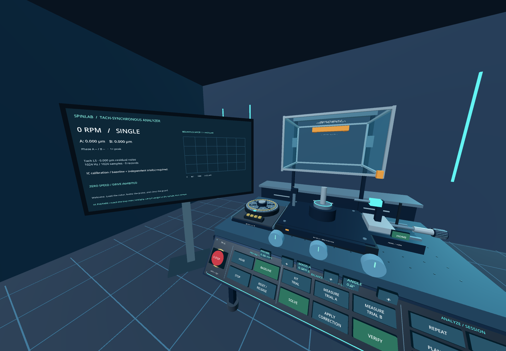
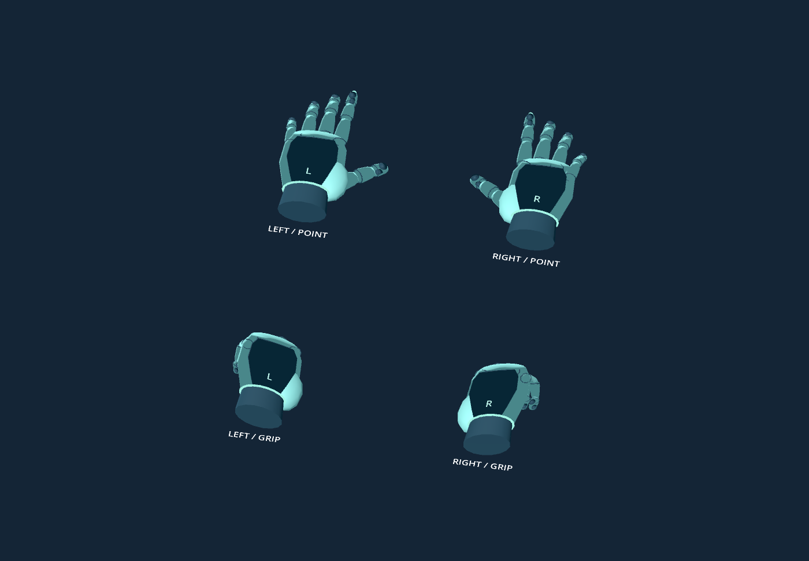
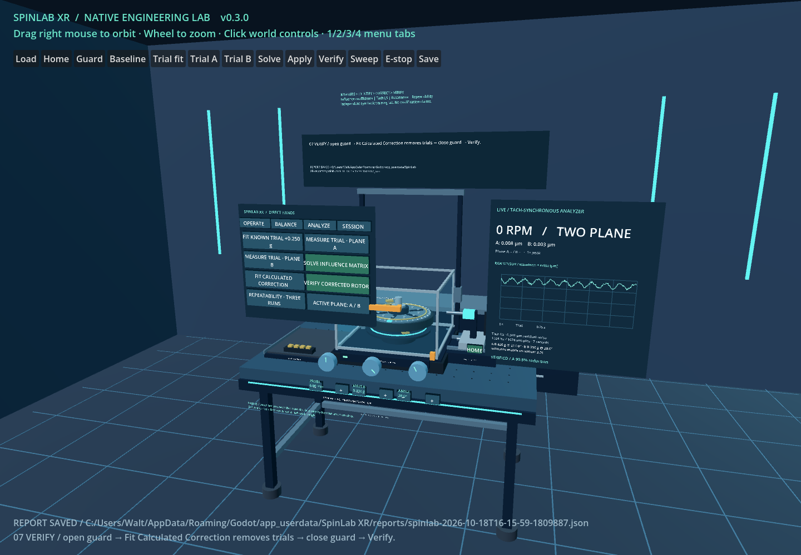
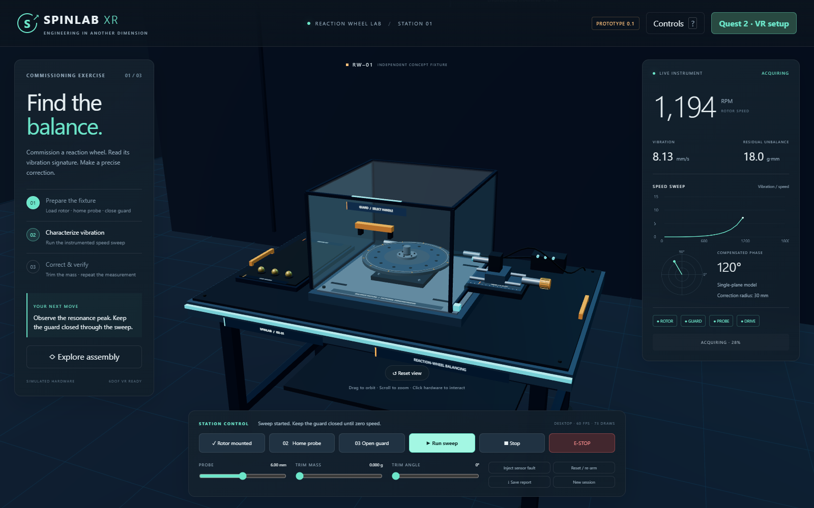

# SpinLab XR

An interactive reaction-wheel balancing and commissioning laboratory for **Meta Quest 2**, built by Walter Teitelbaum. Practice fixture setup, vibration measurement, trial-mass calibration, correction, and verification using synthetic training data.

**Version 0.7.0 uses minimal prompts beside physical controls and bundled spoken work instructions.** The normal workspace has controller-driven gloves, nearby handles and dials, physical command caps, and a lower analyzer to the left of the guard. Four small circular A/B/X/Y markers identify the real Touch button positions above the gloves. B/Y opens the separate three-tab pointer menu and closes it again.

The fifteen-step balancing guide advances after confirmed work. A short action label appears beside the current target; long instructions and relevant measurement theory are spoken in a locally generated neural voice. Audio is bundled in the APK and works offline. The prompt is hidden if no nearby position clears the station and both eye sightlines. In Session, pause/resume, restart, skip, disable guide startup, toggle voice, or replay the current instruction. Right-stick click also replays narration. Use the [installation guide](docs/APK_SETUP.md), [workspace design](docs/UX_DESIGN.md), [tutorial](docs/TUTORIAL.md), [narration provenance and transcript](docs/NARRATION.md), [scientific methodology](docs/NATIVE_RESEARCH.md), and [validation record](docs/NATIVE_VALIDATION.md). Source is in `native/`; build with Godot 4.7.2/OpenXR. The browser version below provides a separate desktop and WebXR preview.

Menu controllers use headset-provided models when available, with pinned Touch v3 GLB assets as a fallback. Meta Capsense supplies controller-driven hand poses over those menu controllers when supported. See [controller visuals](docs/CONTROLLER_VISUALS.md).



The scientific lab measures a baseline and independent trial masses, solves single- or two-plane complex influence coefficients, then verifies a newly installed correction. It synthesizes sampled tach-referenced vibration, fits DC/1×/2× by least squares, displays a 0–100 Hz DFT and resonance sweep, estimates three-window Type A repeatability, and exports scientific JSON records. Numerical analysis runs in isolated workers. No web server or network connection is required after installation.

Use the physical console for operating commands; push with the index tip, then withdraw. The menu retains Balance, Analyze, and Session tools, with no redundant Operate tab. Squeeze the nearby rotor, orange guard handle, or dial to hold it; release to let go. Dials respond to wrist rotation and nearby ± buttons. Keep holding the Touch controllers; optical hand tracking is not required. In the open menu, point and use the index trigger, then choose Close or press B/Y. The left stick adjusts bench height; the right stick walks at up to 0.65 m/s relative to head direction. Walking is suspended during menus, active holds, lost focus, or unavailable tracking and requires the stick to return to neutral before resuming. Recenter is in Session.

```powershell
# Once the local native toolchain is prepared:
.\tools\Build-APK.ps1
.\tools\Install-APK.ps1
# After saving reports in the headset:
.\tools\Pull-Quest-Reports.ps1
```

Fresh Windows build setup: `tools/Setup-NativeToolchain.ps1` downloads pinned Godot/plugin/Android versions plus JDK 17, configures Godot's Android paths, and prepares a local development signing key. Toolchain downloads are large. Keep `.local/spinlab-debug.keystore` for compatible future updates; it is excluded from Git. The APK is a signed development build. Physical headset evidence is recorded separately from software checks.

The v0.7.0 build output is `artifacts/SpinLabXR-v0.7.0.apk`. Download packaged builds from [Releases](https://github.com/jewbee2000/spinlab-xr-public/releases) and retain the installed version/hash with feedback. Headset feedback confirms the automatic Load → HOME → Guard progression, the lower side analyzer, and pointer selection. The new tiny hand markers, contextual prompt placement, and narration require a fresh headset check. Movement comfort, report retrieval, and sustained performance remain pending. See the validation record for exact build/install evidence.





## Browser version 0.1



Mount a rotor, home the probe, close the guard, run a vibration sweep, fit a correction mass, and verify the result. Practice sensor faults, guard trips, and emergency-stop recovery. Save traceable JSON measurements and event history.

## Run the browser preview

Use Node.js 22 or 24 LTS. The app has no npm runtime installation step and no CDN dependencies.

```sh
node tools/serve.mjs
```

Open **http://localhost:8080** on the computer for the desktop preview. For the physical Quest 2, follow [the installation guide](docs/INSTALL_QUEST2.md): enable developer USB debugging, connect a data cable, run `adb reverse tcp:8080 tcp:8080`, open **http://localhost:8080 in Quest Browser**, then select **Enter VR**. Rendering runs on the headset; the computer serves files. Keep the cable and server connected for reloads.

These browser instructions apply to version 0.1. For the standalone version 0.7.0 APK, use the native guide above. Physical acceptance is recorded in the native validation document.

## Browser guided exercise

1. Load rotor, home probe, close guard.
2. Run the 12-second sweep and wait through coast-down to zero speed.
3. Open guard. Set trim mass **0.600 g**, angle **300°**. Close guard.
4. Run again. The modeled initial 18 g·mm imbalance cancels at the fixed 30 mm correction radius. The training pass limit is 2 g·mm.
5. Save report. In VR, leave immersive mode and select **Saved report** to download it. A saved report survives reload; the live station starts fresh after reload.

Phase is an ideally compensated imbalance position, not a raw accelerometer phase. The damped support model and all limits are illustrative. This is not a qualified balancing instrument or a real machine controller.

## Browser controls

- **Quest:** point and trigger; hold a dial with trigger and rotate wrist or use horizontal thumbstick; squeeze over fixture targets; left stick vertically adjusts station height when no dial is held.
- **Desktop:** buttons/sliders; scene drag to orbit; scroll to zoom; Tab/Enter for UI controls.
- **Fault recovery:** wait for zero speed; close guard after a guard trip; release E-stop and reset in separate actions; rehome after sensor fault.

## Engineering documents

- [Floating guide, lesson coverage, and navigation](docs/TUTORIAL.md)
- [Workspace, menu, guide, and movement design](docs/UX_DESIGN.md)
- [Project architecture and development roadmap](docs/PROJECT_PLAN.md)
- [Primary-source research and model assumptions](docs/RESEARCH.md)
- [Quest 2 setup, testing, and troubleshooting](docs/INSTALL_QUEST2.md)
- [Verification and hardware acceptance](docs/TEST_PLAN.md)
- [Asset inventory and scale conventions](docs/ASSETS.md)
- [Demo scenarios and recording guide](docs/DEMO_GUIDE.md)
- [Version 0.1 validation record](docs/VALIDATION.md)

## Verify and package

```sh
node --check src/app.js
node --check src/simulation.js
node --check src/lab-scene.js
node --test tests/*.test.mjs
node tools/package.mjs
```

The portable directory is `artifacts/spinlab-xr`. Serve it with `node tools/serve.mjs`. Browser smoke testing additionally uses Playwright; see [validation](docs/VALIDATION.md). GitHub Actions verifies the model/server and creates the portable artifact.

The fixture geometry, signal models, UI, and teaching scenarios are original project assets. The [asset inventory](docs/ASSETS.md) records their scale and provenance. All measurements are synthetic and intended for training.

Original project: all rights reserved by Walter Teitelbaum. Three.js retains its MIT license; see [notices](THIRD_PARTY_NOTICES.md).
