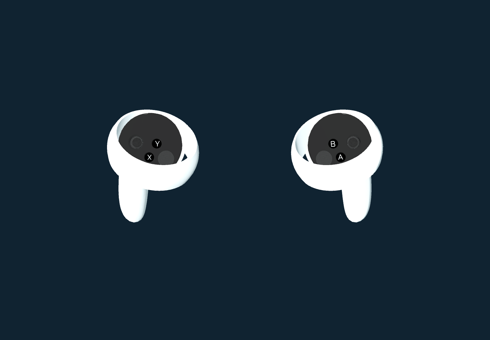

# Quest controller and Capsense visuals

Version 0.6.0 replaces approximate menu-controller geometry with device-oriented assets while retaining the working aim-ray and trigger-selection path. The physical station continues to use the articulated laboratory gloves and nearby interaction logic. B/Y switches presentation; geometry does not become a new input source.

## Device models and fallback

The Godot OpenXR Vendors `OpenXRFbRenderModel` node retrieves the controller GLB exposed by the headset through `XR_FB_render_model`. The project enables `xr/openxr/extensions/meta/render_model`; the vendor exporter adds the required Meta render-model feature and permission. The model is attached in grip space. Load status and animation support are recorded in diagnostics; a static FB runtime model is not described as automatically animated. [Godot vendor node](https://godotvr.github.io/godot_openxr_vendors/api/class_openxrfbrendermodel.html).

A bundled Touch v3 (Quest 2) model pair provides a predictable fallback. Source: Immersive Web input profiles commit `afcd4423001acd0ff981c6860c71ca49c7b43e52`, under MIT with original notice and provenance packaged alongside it. The authored thumbstick/button locations and materials are retained. Application animation interpolates authored min/max/value transforms for input components; touching a capacitive button must never be converted into a press. [Pinned assets](https://github.com/immersive-web/webxr-input-profiles/tree/afcd4423001acd0ff981c6860c71ca49c7b43e52/packages/assets/profiles/oculus-touch-v3).

Godot's newer core `XR_EXT_render_model` support is a separate API. The observed Quest 2 runtime exposes the older FB model path; availability of core nodes alone does not prove support on a headset. [Godot render-model explanation](https://docs.godotengine.org/en/4.7/tutorials/xr/openxr_render_models.html).

## Controller-driven hand poses

Meta Capsense uses controller touch/button signals to infer hand joints, including fingers resting on or lifted from controls. Meta documents this as the pose system used by Horizon Home, with Quest 2 support. Native access uses `XR_EXT_hand_tracking_data_source` with CONTROLLER and `XR_EXT_hand_joints_motion_range` with CONFORMING_TO_CONTROLLER. These are inferred poses, not measurements of individual fingertip positions or hover distance. [Meta native Capsense](https://developers.meta.com/vr/documentation/native/android/native-capsense/).

The project requests the controller hand-data source, not unobstructed optical-hand input. A menu-only visual under `XROrigin3D` uses the runtime palm tracker, `OpenXRFbHandTrackingMesh`, and `XRHandModifier3D`; it is not parented to the grip again. Conforming motion range keeps the displayed fingers wrapped around the controller. Visibility requires a ready mesh, current controller-source joint data, valid palm pose, tracked grip, menu mode, input focus, and a valid headset pose. Unsupported or unavailable Capsense leaves the accurate controller and working pointer available. The runtime hand skin uses a neutral translucent material; identical Horizon Home shading is not claimed.

Runtime diagnostics distinguish a loaded model or valid controller-source hand pose from merely enabling a feature. Physical button/stick alignment, touch-driven finger motion, interruption recovery, visual comfort, and foreground performance require headset observation. Software checks cannot establish those properties.
