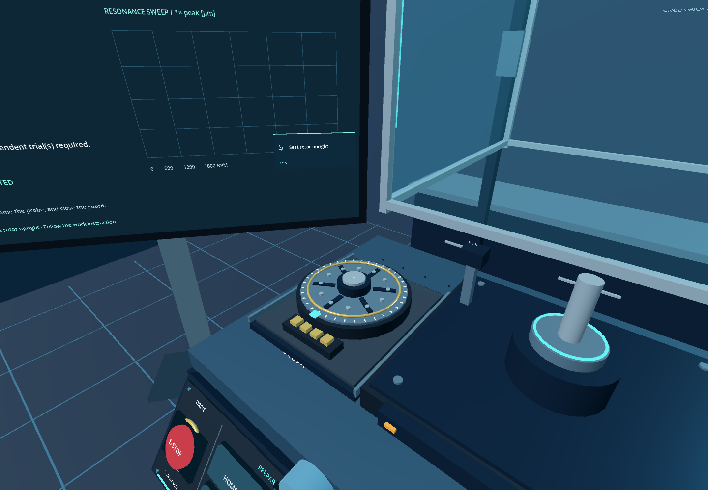

# Operator interaction redesign

Version 0.8.0 keeps the physical station, analyzer, contextual spoken guide, and application menu separate. The operator found v0.7.0's speech and small button markers substantially better, but identified overlapping dial labels, missing beginner concepts and micrometer practice, and an empty graph. This revision removes redundant controls, expands the learning experiment, and presents explicit acquired-data plots. Its new placement, reach, and complete lesson need a fresh headset run.

## Workstation and menu

The default view is the laboratory. Reach with the controller-driven gloves to carry the rotor, lower/latch the guard, turn the actual probe micrometer and the Mass/Angle dials, and press physical station controls. A dedicated monitor presents the measurements and plots. Its placement and larger text replace the dense collection of floating readouts around the fixture.

The analyzer is a 1.86 × 1.06 m display mounted to the **left of the guard**, centered at station-local `(-1.55, 1.45, -1.20)` m and yawed +50° so its front (+Z) faces the operator. Its center is lower than the former overhead display. The floor stand has a fixed base and overlapping telescopic sections; station height moves the screen without raising the foot off the floor. Readout fonts are larger, and initial/verified field widths are checked against their available columns. Reading the side display requires looking left or walking closer; no headset readability guarantee follows from a desktop render.

The tutorial visual is a **0.24 × 0.10 m target-adjacent callout**. It shows a small directional graphic, a two-to-five-word imperative such as “Press BASELINE,” compact progress such as “4/15,” and an optional one-word status. Long instructions, theory paragraphs, DO THIS/WHY headings, and controller footers are removed entirely from this visual. Bundled natural spoken clips explain the task and engineering purpose offline. Source lesson text remains available to narration and documentation; shrinking or truncating a paragraph is not the visual strategy.

The callout follows the current physical button, orange guard handle, or rotor. Candidate positions use offsets in the target's coordinates, within 0.48 m of it; head movement changes its facing direction rather than dragging a reading card around the user. The application resolves the moving target and rechecks placement against current geometry, including guard travel and workstation height. A small arrow and fixture highlight keep the instruction's relationship to the real control clear.

`target_callout_placement.gd` tests the **entire rotated card's conservative world AABB**, with 12 mm clearance, against visible hardware bounds. This includes bench, guard glass/frame, probe, rotor, monitor, and other supplied geometry. CPU mesh bounds and cached original MultiMesh instance transforms avoid dummy-renderer identity-readback errors. A single descriptor capture retains hidden meshes as well; every subsequent world pass reads current visibility and transforms, including held rotors, moving guards, and height changes. Physical collision bounds include transparent glass; opaque visibility bounds exclude explicitly translucent materials. The helper checks the complete finite viewing pyramid for each of two eyes at ±40 mm from the tracked center, using face/edge separating axes rather than sampled rays. Conservative model bounds can hide a usable candidate, but an intersecting foreground box cannot be accepted merely because it falls between sample rays. It also rejects prompts overlapping the target's full projected visual bounds and candidates below the floor.

If every nearby candidate is obstructed, the prompt **hides**; the target highlight and spoken guidance remain available. There is no unchecked fallback position inside hardware and no large head-relative card. These guarantees are relative to the actual bounds supplied by the application, not an assumption about unmeasured physical surroundings. Custom shader displacement and unknown geometry require appropriate bounds. Headset optics, narration intelligibility, arbitrary user viewpoints, and physical comfort still need hardware acceptance.



The 38-step two-plane course starts with an understandable problem and experiment: off-axis mass creates rotating force; known trial masses reveal measured sensitivity; a calculated correction must be verified. Early tactile tasks teach the actual micrometer, Mass and Angle, editing planes, speed, and safe stopping. The learner reads the time/order plots, measures independent A/B trials, applies a prediction, explores speed response, then finishes with matched-speed verification, repeatability, and a saved report. [TUTORIAL.md](TUTORIAL.md) records the full path.

Accepted work advances immediately when its real completion conditions hold; speech never adds a wait. Entering the next task replaces the current clip. The learner can listen first before acting to hear the full explanation. Held adjustments must be released, guards must latch, and captures must complete analysis/coast-down. X reviews without moving the work checkpoint; A returns forward through review or continues an already ready task. Navigation never operates equipment. After a setup change or fault invalidates post-baseline calibration, the guide directs required recovery/HOME and returns to a fresh baseline and independent trials while retaining historical records.

The sole probe adjustment is the drum on the actual carriage at the station's right side; the front Probe dial and all ± controls were removed. Mass and Angle names/values are printed within their existing circular knob faces, with a small marker on the rim. The STANDOFF display is a compact plaque behind the micrometer. These add no independent mass/angle label panels in front of other controls; glyph fit and hardware sightlines are checked. Release/regrip supports repeated wrist turns. The console provides exactly one physical cap for each operating command, including HOME and SPEED. Readout placement is validated separately from headset readability.

The monitor begins on TIME, automatically selects TIME on ordinary capture and SWEEP for a sweep, and labels missing data rather than inventing a curve. Thick, distinct sensor A/B traces, numerical ticks, a zero reference, and explicit units support comparison. ORDER normalizes DFT frequency by the captured shaft frequency and marks 1×/2×. Stored capture speed governs that plot even if the next test-speed setting changes. See [ANALYZER.md](ANALYZER.md) for axes, data selection, and empty states.

**B or Y opens/closes an explicit menu.** Opening it replaces the simulated gloves with runtime-supplied controller models, supported Capsense hands, and aim pointers. Point and use the trigger to choose menu controls. Menu input has its own collision layer; it must not reach through the menu to actuate physical buttons. Pointer selection and grip acquisition require release/rearming after interruption; fingertip contact requires a fresh front approach after the menu closes. Merely opening the menu does not reset the model or start/stop a measurement.

The menu has exactly two categories: **Tools** and **Session**, with the active tab highlighted. Tools contains only sensor disconnect, tachometer loss, exploded/assembled view, and motor sound. Session manages guidance, narration, walking, recentering, and New Session. Ordinary operating commands and SAVE REPORT are available only on the physical console, avoiding a second control surface to learn. Exit through the Quest system menu. B/Y always opens/closes this visible pointer mode.

## Menu controller models and Capsense hands

The menu prefers the headset's controller model through the pinned OpenXR Vendors `OpenXRFbRenderModel` API, attached to the grip pose. If unavailable, pinned MIT-licensed Quest 2 Touch v3 GLB assets provide the correct controller layout; authored control transforms animate the fallback. Model appearance does not change the action map or aim ray.

Controller-conforming hands use Meta's Capsense data through `XR_EXT_hand_tracking_data_source` and `XR_EXT_hand_joints_motion_range`. A runtime hand mesh and `XRHandModifier3D` follow the controller-derived joint poses, including capacitive touch behavior, when valid data are available. The overlay is translucent, depth-tested, and visual only. It is hidden outside the menu or when grip/head tracking, focus, mesh readiness, or controller-source joint validity is missing. Optical/unknown hand data cannot substitute for controller poses. The tracked palm hierarchy sits directly under `XROrigin3D`, preventing a second grip transform. [Meta native Capsense](https://developers.meta.com/vr/documentation/native/android/native-capsense/), [vendor runtime model API](https://godotvr.github.io/godot_openxr_vendors/api/class_openxrfbrendermodel.html).

Physical-work mode retains controller-driven gloves. Small letter markers identify the actual Touch buttons without wrist text panels. The operator liked the small v0.7.0 markers and voice presentation. Menu controller alignment, Capsense finger placement, and hover behavior still require their own specific hardware observations; that feedback does not establish every optional runtime feature.

## Physical button markers

In glove mode, small circular markers show **X/Y** on the left controller and **A/B** on the right. They identify button locations rather than presenting a control map, work instruction, or wrist legend. The markers are visual only, depth-tested, and have no collision or ray targets. Placement follows the complete controller grip transform, including wrist rotation. Opening the pointer menu hides the glove-mode markers; tracking and focus gates prevent stale markers when the pose is unavailable.

The controller map below documents each button's function. Automatic procedure progress needs no repeated A press. Actual marker/controller alignment and unobstructed physical reaching require headset feedback.

## Chosen controller map

| Input | Menu closed / laboratory | Menu open |
| --- | --- | --- |
| B or Y | Open menu; show controller pointers. | Close menu; return to gloves. |
| Right A | Optional review: continue only when the current objective is ready. | No hidden physical station action. |
| Left X | Review the previous guide stage. | No hidden physical station action. |
| Index trigger | Animate the index finger; release it to extend the visible fingertip for physical pressing. | Select a pointed menu control after a fresh release/press. |
| Side grip | Acquire/release an actual nearby rotor, handle, or dial. | Does not acquire hidden mechanical targets. |
| Right stick | Walk horizontally relative to head direction when navigation is permitted. | No walking. |
| Right-stick click | Replay the current spoken explanation. | Use Session → Replay Voice. |
| Left stick vertical | Adjust station height when no mechanism is held. | No station movement. |
| Physical index-tip press | Actuate a front-facing physical button once per deliberate approach/withdrawal. | Disabled. |

Chart changes belong to the physical CHART cap; A/X provide optional guide review; normal progression follows confirmed work. A loose squeeze with no acquired object must not suppress all fingertip presses. Actual held-object state, tracking, and the contact state machine govern whether physical contact is available. The existing front-approach, actuation stroke, shared latch, and withdrawal rules remain in effect.

Desktop review uses M for the explicit menu, 1–2 for its categories, Space for ready-review Next, and Backspace for review Back. Desktop clicks and renders exercise shared command behavior, not stereo or actual Touch pose alignment.

## Commanded walking

The right stick controls slow head-relative translation. This is a deliberate project mapping: Meta describes left-stick movement/right-stick turning as the familiar controller convention, while allowing application-specific mappings. Here the left stick retains workstation height and the right stick provides movement without artificial rotation. Input gates prevent walking from conflicting with menu selection or precision manipulation. [Meta, artificial locomotion input maps](https://developers.meta.com/vr/design/locomotion-input-maps/).

`native/scripts/operator_navigation.gd` contains pure math with two static functions:

```gdscript
movement(stick: Vector2, headforward: Vector3, delta: float) -> Vector3
constrain_motion(position: Vector3, step: Vector3,
    bench_center: Vector3, bench_half_extents: Vector2,
    margin: float = 0.25) -> Vector3
```

Pass `headforward = -camera.global_basis.z`. Positive stick Y moves forward and positive X moves right. `movement()` projects the head direction onto XZ and normalizes it, removing pitch so looking up/down never creates elevation or changes nominal speed. A missing, exactly vertical, or invalid heading produces no motion. The helper does not invent a fallback yaw.

The radial deadzone is **0.18**. Above it, stick strength is remapped continuously from zero to one. The direction is normalized before applying strength, so diagonals and over-range finite input cannot exceed **0.65 m/s**. Delta is capped at **0.05 s**; a stalled frame cannot create a catch-up jump larger than 3.25 cm. There is no velocity retained after the stick is released, no artificial yaw, and no camera bob or vertical motion.

The application must permit walking only with the menu closed, walking enabled, current app/XR input focus, valid current headset/controller tracking, and no acquired mechanical handle. It must rearm navigation only after the stick returns to the deadzone following a menu transition, tracking/focus loss, recenter, or held-object interaction. A stale deflected stick must not restart walking automatically. These runtime gates belong to `main.gd`; the pure helper receives only stick, heading, and time.

The collision position is the **actual tracked head's world X/Z**, not the tracking origin. Main applies `allowed_position - actual_head_position` to `XROrigin3D`, preserving tracked head/hand relationships. Godot distinguishes the tracking origin from the physically displaced user and explains why testing collision at the origin can be wrong. It also describes why forcibly cancelling physical head movement can create a visual/vestibular mismatch. [Godot 4.7, room scale in XR](https://docs.godotengine.org/en/4.7/tutorials/xr/xr_room_scale.html).

## Fixture and room constraints

`constrain_motion()` returns an **absolute allowed head-ground position** and preserves the input Y. It ignores `step.y`. For the current station, main supplies:

```gdscript
bench_center = station.to_global(Vector3(0, 0, -1.4))
bench_half_extents = Vector2(0.85, 0.475)
margin = 0.18
```

The bench's world-aligned XZ rectangle is expanded by the clearance margin. A swept segment test detects crossing even when a large commanded step ends beyond the opposite side. At a face, the blocked component stops while the tangent slides. A simultaneous inward corner collision blocks both components; tangential edge travel and paths merely grazing a corner remain available. This allows the operator to walk around all sides without cutting through the table. The helper's default margin remains 0.25 m for other callers; the application explicitly chooses 0.18 m.

Artificial motion also stays within **X = −3.2 to +3.2 m** and **Z = −2.70 to +2.8 m**. The rear limit includes clearance before the workshop wall at world Z = −2.95 m; the floor continues beyond that wall. A side component can slide along the room boundary. Bench height changes move the station rather than its surrounding room/floor.

An actual physical step, recenter, or fixture relocation can put the tracked head inside the bench rectangle or outside the virtual room bounds. The helper does not eject or snap that head position. While already inside the bench clearance, it permits only commanded recovery toward a nearest exit face. While outside a room boundary, it blocks deeper movement and allows gradual inward recovery. With no commanded movement it returns the same position. This constrains artificial translation; it cannot restrain physical movement.

The collision model is intentionally limited to the table footprint and virtual room limits. It is not a full character body, a model of every prop/monitor, or a replacement for the headset's physical play-area boundary. Nonfinite input or invalid obstacle dimensions fail closed. The caller must supply a finite tracked position and an axis-aligned station; arbitrary rotated benches need an explicit local-space transformation.

## Comfort and acceptance

Slow bounded movement and automatic input gating are design choices, not evidence that smooth locomotion is comfortable for every user. Walking can be turned off in Session, and fixture operation remains possible from the operator position. Meta recommends controlling acceleration/elevation and considering comfort alternatives; no vignette, teleport, snap-turn, or fitted comfort guarantee is claimed by this helper. [Meta, locomotion best practices](https://developers.meta.com/vr/design/locomotion-best-practices/), [comfort and usability](https://developers.meta.com/vr/design/locomotion-comfort-usability/).

The pure `native/tests/test_navigation.gd` suite checks deadzone/analog strength, cardinal/diagonal direction, yaw/pitch, invalid input, delta limits, room boundaries, large swept crossings, face sliding, corner entry/grazing, translated bench geometry, gradual invalid-start recovery, a complete route around the bench, and deterministic adversarial paths. It does not test physical comfort or headset/controller input delivery.

Application and headset acceptance must additionally check:

- B/Y changes only the intended interaction mode; menu pointers cannot activate hidden station buttons, and closing a menu with trigger/grip held requires fresh release.
- Confirmed work advances immediately without waiting for speech; incomplete/rejected work does not. The small prompt stays beside the moving target, has no hardware intersection or opaque foreground obstruction, and hides if no safe candidate exists. Spoken instruction/science remains intelligible without onscreen paragraphs. A continues only a ready work/review stage and X reviews.
- Actual loose grip does not disable fingertip buttons; an acquired tool does. Each hand can press, withdraw, carry, latch, and rotate the intended control.
- Right-stick walking follows head yaw at a consistent speed, stops immediately on neutral/menu/hold/tracking/focus loss, and requires rearming after interruption. Left-stick height cannot raise the room floor or move a held mechanism unexpectedly.
- The head can travel around the expanded bench rectangle without tunneling, sticky corners, forced elevation, or a sudden recovery snap. Recenter remains explicit and restores a usable operator position.
- Seated and standing users can disable walking, read the analyzer and short target prompt, hear the spoken task/purpose, reach required controls, and complete a measured balancing exercise. Record the actual APK hash, headset OS/runtime, tracking interruptions, perceived comfort, and sustained foreground performance separately.

The v0.6 automatic-procedure confirmation and positive v0.7.0 feedback on minimal prompts, voice, and markers are retained. The revised v0.8.0 lesson, labels, graph reading, and hardware reach still require a physical run, separate from software test counts.
